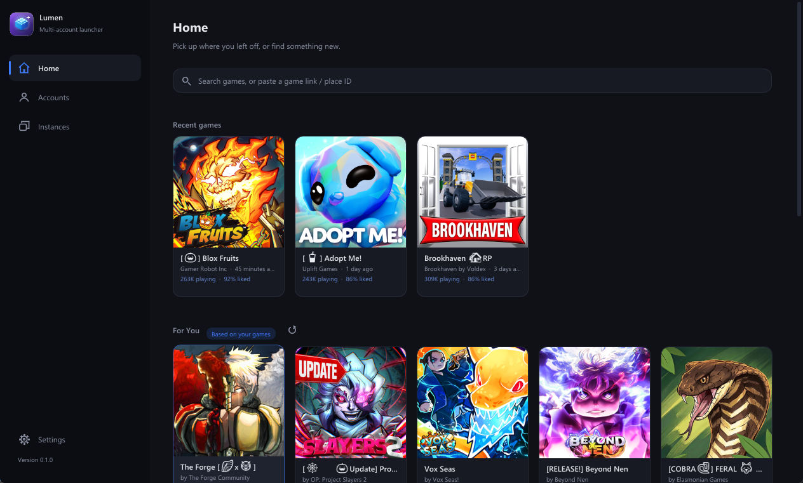
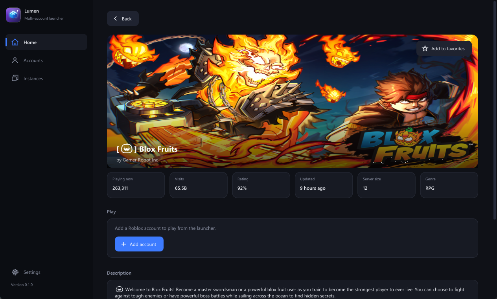
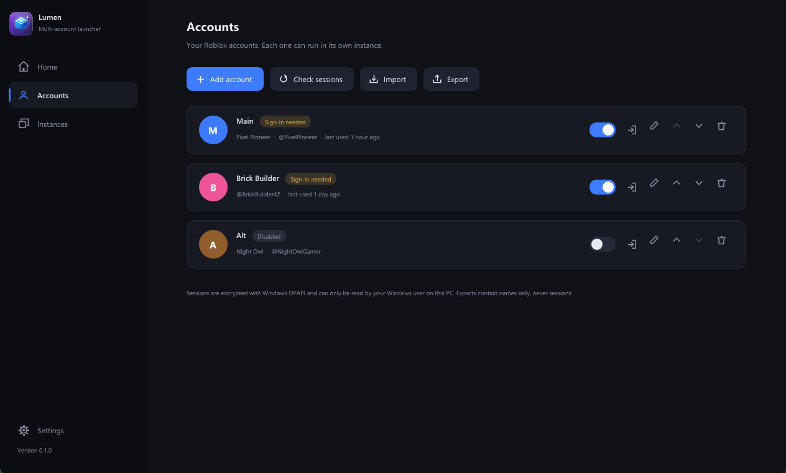
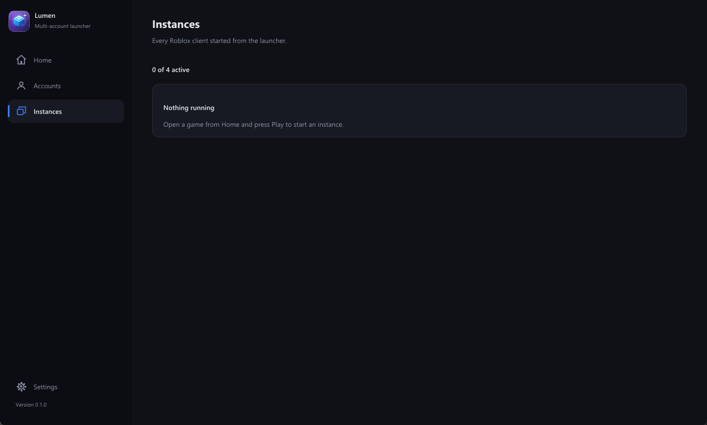
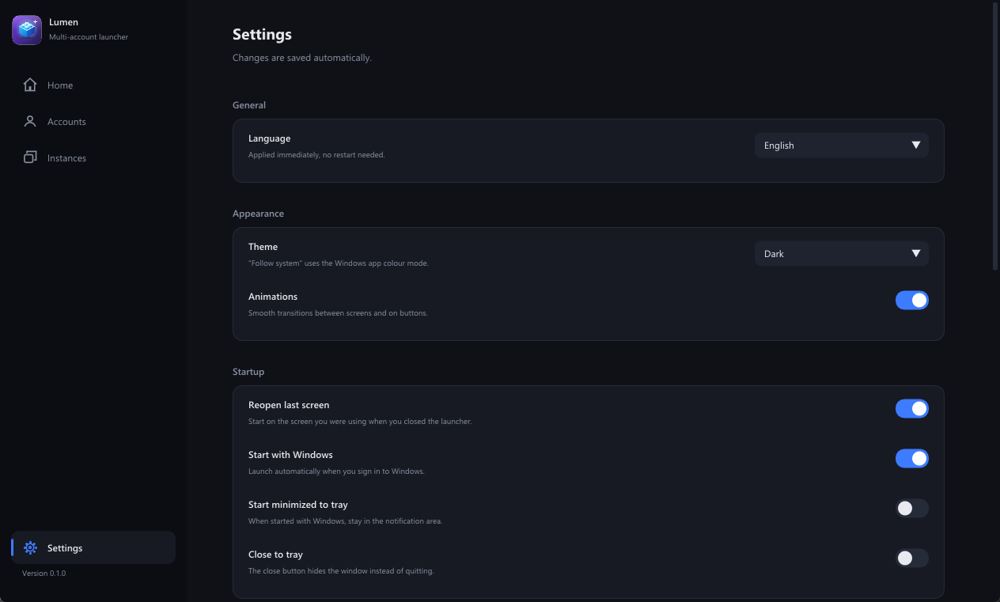

# Lumen

🇬🇧 [English](README.md) · 🇮🇹 **Italiano**

**Lumen** è un launcher alternativo e non ufficiale per Roblox su Windows. Permette di tenere più account Roblox nello stesso posto e di avviare più client contemporaneamente, ognuno con il suo account. È scritto in C++17 con Dear ImGui.

> ⚠️ **Lumen non è affiliato, approvato o sponsorizzato da Roblox Corporation.** "Roblox" è un marchio di Roblox Corporation. Lumen non modifica il client di Roblox, non inietta codice e non aggira nessuna protezione del gioco: avvia il client ufficiale nello stesso modo in cui lo avvia il sito roblox.com.

| Home | Dettaglio gioco |
|---|---|
|  |  |

| Account | Istanze | Impostazioni |
|---|---|---|
|  |  |  |

*Gli screenshot usano account dimostrativi inventati.*

---

## 1. Funzionalità principali

- **Più account**: aggiungi, rinomina (alias locale), colora, riordina, abilita o disabilita ed elimina gli account. L'export e l'import della lista contengono solo metadati e **mai** i cookie.
- **Login sicuro dal browser**: Lumen mostra un codice e apre roblox.com nel browser predefinito, dove confermi l'accesso ("Accedi con un altro dispositivo"). Lumen non vede e non memorizza mai la password.
- **Cookie cifrati**: il cookie di sessione è cifrato con la DPAPI di Windows e non compare mai nei log.
- **Più istanze**: ogni gioco può partire con un account diverso, con un limite configurabile (1–10) e un ritardo tra un avvio e l'altro. La schermata Istanze mostra i client aperti e permette di chiuderli.
- **Home**:
  - **Giochi recenti**: con data dell'ultimo avvio; il massimo è configurabile e ogni gioco si può rimuovere.
  - **Ricerca**: usa le API pubbliche di Roblox con un debounce di 300 ms e mostra miniatura, creatore, giocatori online e valutazione.
  - **Per Te**: suggerimenti calcolati in locale (vedi sotto).
- **Scheda gioco**: banner, descrizione, creatore, giocatori, valutazione e ultimo aggiornamento, con la scelta dell'account, il pulsante Gioca e i preferiti.
- **Impostazioni**:
  - lingua italiano/inglese, cambiabile al volo senza riavvio;
  - tema scuro, chiaro o di sistema;
  - avvio con Windows, avvio ridotto a icona, chiusura nell'area di notifica;
  - opzioni per le istanze, la cache e la cronologia;
  - reset completo.
- **Robustezza**:
  - rete non bloccante con cache, retry con backoff esponenziale e verifica TLS;
  - scritture JSON atomiche, con backup dei file corrotti;
  - log a rotazione.

### Come funziona "Per Te"

I suggerimenti si basano **solo sulla lista dei giochi recenti**, salvata in `recent_games.json`. Per ogni gioco vengono usati il genere, il creatore, quante volte l'hai avviato e quando l'hai avviato l'ultima volta. Ogni avvio pesa la metà ogni 14 giorni. Da questi dati Lumen calcola le tue preferenze per genere e per creatore e ordina i giochi popolari di Roblox in base a:

`3 × affinità di genere + 2 × affinità di creatore + 0,6 × popolarità + 0,4 × valutazione`

I giochi già giocati vengono esclusi. Se la cronologia è vuota, Lumen mostra semplicemente i giochi più popolari. Nessun dato viene inviato a terzi.

**Per resettarli** scegli **Impostazioni → Dati e cache → Cancella giochi recenti**, oppure cancella `recent_games.json` (vedi la sezione 5).

---

## 2. Requisiti

**Per usarlo**
- Windows 10 o 11 a 64 bit.
- Roblox installato, cioè il protocollo `roblox-player:` registrato. Funziona anche con launcher come Bloxstrap.

**Per compilarlo**
- CMake ≥ 3.20.
- Un compilatore C++17:
  - **MSVC**: Visual Studio 2022 con il carico di lavoro "Sviluppo di applicazioni desktop con C++";
  - oppure **MinGW-w64**: GCC ≥ 12, testato con WinLibs GCC 16 UCRT, più Ninja.
- Connessione a Internet al primo configure: le dipendenze vengono scaricate con `FetchContent`.
  - Dear ImGui 1.91.5, con backend Win32 + DirectX 11;
  - nlohmann/json 3.11.3;
  - stb_image, per decodificare le miniature PNG e JPEG;
  - doctest 2.4.11, per i test.
- Le librerie di sistema (WinHTTP, DPAPI/crypt32, DirectX 11, DWM) fanno già parte di Windows: non serve installare nient'altro.

---

## 3. Compilazione

Esegui i comandi dalla cartella del progetto.

### MinGW (Ninja)

Con WinLibs, ad esempio: `winget install BrechtSanders.WinLibs.POSIX.UCRT Kitware.CMake Ninja-build.Ninja`.

```bash
cmake --preset mingw-release
```

```bash
cmake --build --preset mingw-release
```

L'eseguibile si trova in `build/mingw-release/Lumen.exe`. Il runtime è collegato staticamente, quindi non servono DLL di MinGW. Per la versione di debug usa il preset `mingw-debug`.

### MSVC (Visual Studio 2022)

Da un "Developer PowerShell for VS 2022", oppure da un terminale normale: il generatore trova Visual Studio da solo.

```bash
cmake --preset msvc
```

```bash
cmake --build --preset msvc --config Release
```

L'eseguibile si trova in `build/msvc/Release/Lumen.exe`. In alternativa puoi aprire `build/msvc/RobloxLauncher.sln` in Visual Studio.
*Nota: la build MSVC è configurata ma in questo ambiente è stata verificata solo con MinGW.*

### Test

```bash
ctest --test-dir build/mingw-release --output-on-failure
```

I test unitari (doctest) coprono:
- localizzazione: parità delle chiavi e dei segnaposto tra `it.json` ed `en.json`, plurali, formati di numeri e date;
- impostazioni e scritture atomiche;
- cifratura DPAPI e persistenza degli account;
- parser delle API, login rapido e cookie;
- cronologia, preferiti e suggerimenti;
- costruzione dell'URI di avvio.

### Distribuzione

```bash
cmake --install build/mingw-release --prefix dist/Lumen
```

Il comando copia `Lumen.exe`, la cartella `locales/`, `README.md` e `LICENSE`. La cartella `locales/` deve restare accanto all'eseguibile.

---

## 4. Uso

### Aggiungere un account
1. Vai su **Account → Aggiungi account**.
2. Lumen mostra un codice di 6 caratteri e apre `roblox.com/crossdevicelogin/ConfirmCode` nel browser predefinito.
3. Se non hai già fatto l'accesso nel browser, accedi a roblox.com come fai di solito. Poi inserisci il codice e conferma alla domanda "Vuoi accedere…?".
4. Lumen riceve la sessione, la cifra e aggiunge l'account. Il codice scade dopo pochi minuti: se scade, premi **Riprova**.

Se la sessione di un account scade, l'account mostra "Sessione scaduta" e il pulsante **Accedi di nuovo** ripete la stessa procedura.

### Avviare un gioco
1. Cerca il gioco nella Home oppure aprilo dai recenti, dai preferiti o da "Per Te".
2. Nella scheda del gioco scegli l'account e premi **Gioca**.
3. Prima dell'avvio Lumen verifica che Roblox sia installato e che la sessione sia valida. Poi chiede a Roblox un ticket di accesso monouso e apre il client tramite il protocollo `roblox-player:`.

### Avviare più istanze
1. In **Impostazioni → Istanze** attiva **Consenti più istanze**, poi scegli il numero massimo e il ritardo tra gli avvii.
2. **Chiudi tutti i client Roblox** prima del primo avvio: Lumen deve "prendere" il blocco di istanza singola di Roblox prima che parta un client.
3. Avvia lo stesso gioco, o giochi diversi, con account diversi. Ogni istanza compare in **Istanze**, dove puoi chiuderla.

Come funziona:
- Roblox impedisce più client creando un mutex chiamato `ROBLOX_singletonMutex`. Lumen lo crea per primo e lo tiene aperto, così i client successivi non lo trovano occupato.
- Lumen tiene anche aperto in sola lettura il file `%LOCALAPPDATA%\Roblox\LocalStorage\RobloxCookies.dat`. Così un client non può riscriverlo e disconnettere gli altri, perché ogni istanza riceve il proprio ticket.
- Quando l'ultima istanza si chiude, Lumen rilascia entrambi.

Questo è un comportamento **non ufficiale**: Roblox non supporta il multi-istanza e potrebbe cambiare il client in qualsiasi momento. Usalo nel rispetto dei Termini di Roblox.

---

## 5. Dove sono i dati e come cancellarli

Tutti i dati stanno in `%LOCALAPPDATA%\Lumen\`. Se esiste la vecchia cartella `%LOCALAPPDATA%\RobloxLauncher\`, viene spostata qui al primo avvio.

Per usare un'altra cartella (copia portatile o profilo separato) avvia `Lumen.exe --data-dir "D:\percorso\cartella"`. Ogni cartella dati ha un proprio Lumen, indipendente da quello normale.

| File / cartella | Contenuto |
|---|---|
| `settings.json` | Impostazioni |
| `accounts.json` | Account (metadati) e cookie **cifrati con DPAPI** |
| `recent_games.json` | Cronologia dei giochi, usata da "Per Te" |
| `favorites.json` | Preferiti |
| `cache/thumbnails/` | Miniature scaricate, con un limite configurabile in MB |
| `logs/` | Log a rotazione: 1 MB per file, 3 file. Cookie, ticket e token vengono oscurati |

Il cookie si può decifrare solo **con lo stesso utente Windows sullo stesso PC**. Copiare `accounts.json` su un altro computer non serve a nulla: lì gli account vanno ricollegati.

**Per cancellare i dati**:
- **Impostazioni → Dati e cache** permette di aprire la cartella dati, svuotare la cache, cancellare i giochi recenti o fare un **reset completo**: account, impostazioni, cronologia, preferiti e cache.
- A mano: chiudi Lumen (anche dall'area di notifica) ed elimina la cartella `%LOCALAPPDATA%\Lumen\`.
- Se avevi attivato "Avvia con Windows", disattivalo prima nelle impostazioni, oppure rimuovi il valore `Lumen` da `HKCU\Software\Microsoft\Windows\CurrentVersion\Run`.

Per revocare davvero una sessione anche lato Roblox, usa **roblox.com → Impostazioni → Sicurezza → Esci da tutte le altre sessioni**.

---

## 6. Perché Dear ImGui

- **Leggera e senza dipendenze pesanti**: un eseguibile unico di pochi MB, senza runtime esterni come Qt, .NET o WebView. Si compila allo stesso modo con MSVC e MinGW.
- **Grafica moderna con poco codice**: il disegno è personalizzato (card, animazioni, temi scuro e chiaro, ridimensionamento DPI), quindi l'aspetto non dipende dai controlli di Windows.
- **Rendering con DirectX 11**, sempre disponibile su Windows 10/11, e un loop "a riposo" che ridisegna solo quando serve, per non consumare CPU o GPU in background.
- **Contro**: ImGui non gestisce l'accessibilità (screen reader) e il testo complesso (RTL) è limitato. Per un launcher di giochi in italiano e inglese è un compromesso accettabile.

---

## 7. Struttura del progetto

```
RobloxLauncher/
├─ CMakeLists.txt, CMakePresets.json
├─ cmake/                Dipendenze (FetchContent) e warning del compilatore
├─ assets/               Icona, manifest (DPI, UTF-8), risorse di versione
├─ locales/              it.json, en.json
├─ src/
│  ├─ main.cpp           Istanza singola, DPI, COM, avvio
│  ├─ app/               Application (composizione), finestra DX11, tray, dialoghi file
│  ├─ core/              Log, percorsi, scrittura atomica, thread pool, errori, autostart
│  ├─ settings/          Modello e persistenza delle impostazioni
│  ├─ i18n/              Localizer: stringhe, plurali, numeri e date
│  ├─ robloxapi/         Client WinHTTP, parser JSON, API Roblox con cache
│  ├─ accounts/          Account, DPAPI, login rapido
│  ├─ instances/         Ricerca di Roblox, avvio e monitoraggio dei client, multi-istanza
│  ├─ games/             Recenti, preferiti, motore "Per Te", ricerca
│  └─ ui/                Tema, font, widget, componenti, cache texture, schermate
├─ tests/                Test unitari (doctest)
├─ tools/                Script di supporto (generazione dell'icona)
└─ docs/screenshots/
```

La UI non contiene logica di business: le schermate chiamano i servizi (`AccountService`, `GameService`, `InstanceManager`) e ricevono i risultati sul thread della UI attraverso una coda.

---

## 8. Limitazioni note

- **Non affiliato a Roblox Corporation.** Usa Lumen a tuo rischio e nel rispetto dei [Termini di utilizzo di Roblox](https://en.help.roblox.com/hc/articles/115004647846).
- **API non documentate**:
  - il login rapido usa gli endpoint di "Accedi con un altro dispositivo" (`auth-token-service`, `v2/login` con `AuthToken`);
  - l'avvio usa `authentication-ticket` e il protocollo `roblox-player:`;
  - la ricerca usa `omni-search` ed `explore-api`.

  Sono gli stessi endpoint che usa il sito, ma non sono un'API pubblica ufficiale: Roblox può cambiarli o bloccarli in qualsiasi momento.
- **Multi-istanza non ufficiale**: dipende dai nomi del mutex e del file dei cookie usati oggi dal client e può smettere di funzionare dopo un aggiornamento di Roblox. Se Roblox è già aperto quando avvii la prima istanza, il multi-istanza non è disponibile finché non chiudi tutti i client.
- **Verifiche aggiuntive**: se Roblox chiede un captcha o una verifica in più durante il login, Lumen mostra un errore. Completa l'accesso sul sito e riprova.
- Il rilevamento del processo avviato si basa sul nome `RobloxPlayerBeta.exe`. Con launcher di terze parti che rinominano il client, le istanze potrebbero non essere tracciate.
- Solo Windows 10/11 a 64 bit. La build MSVC non è stata verificata in questo ambiente.
- Nessuna accessibilità per screen reader (limite di Dear ImGui).

---

## 9. Licenza

Distribuito con licenza **MIT**: vedi [LICENSE](LICENSE).
Le librerie di terze parti hanno le loro licenze: Dear ImGui (MIT), nlohmann/json (MIT), stb_image (MIT / pubblico dominio) e doctest (MIT).

---

## 10. Crediti

- **Idea, requisiti e test sul campo**: [MytakGames](https://github.com/MytakGames).
- **Sviluppo**: scritto da **Claude** (Claude Opus 5.5 di [Anthropic](https://www.anthropic.com)) con [Claude Code](https://claude.com/claude-code). Claude ha curato architettura, codice, test, icona e documentazione.
- Librerie: [Dear ImGui](https://github.com/ocornut/imgui), [nlohmann/json](https://github.com/nlohmann/json), [stb](https://github.com/nothings/stb), [doctest](https://github.com/doctest/doctest).
