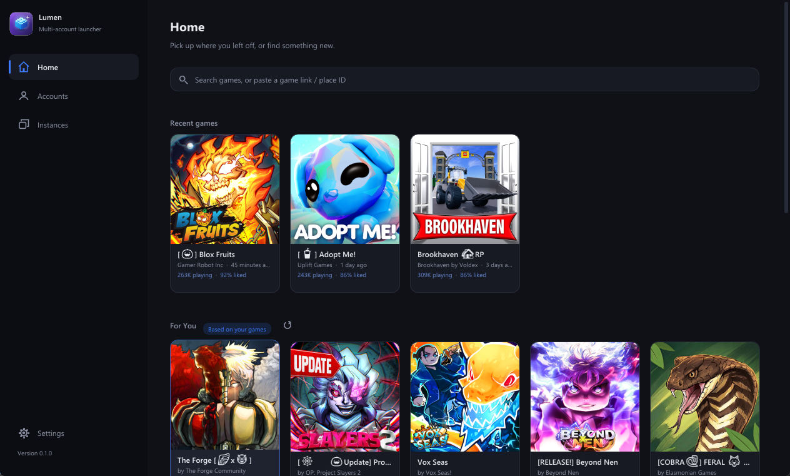
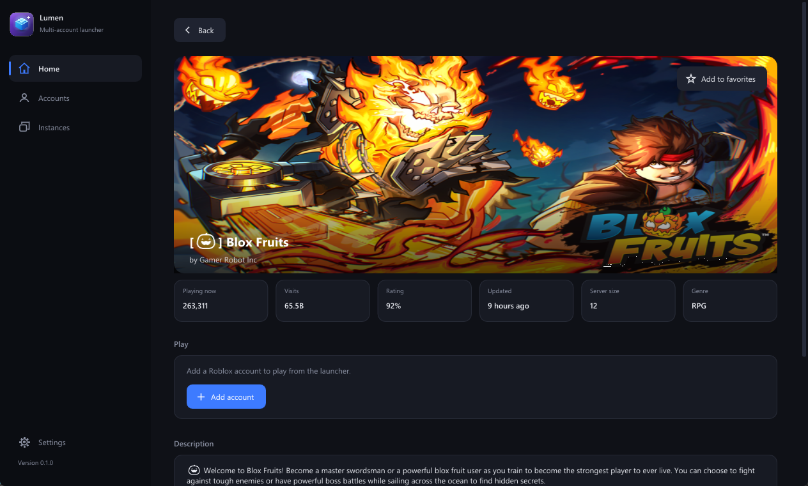
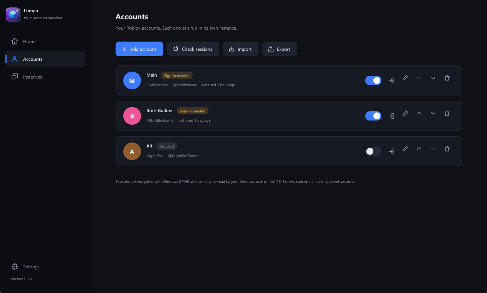
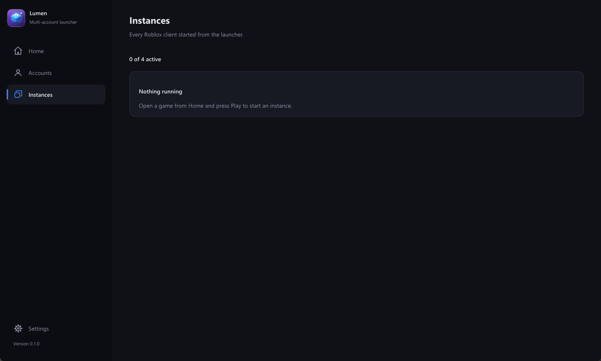
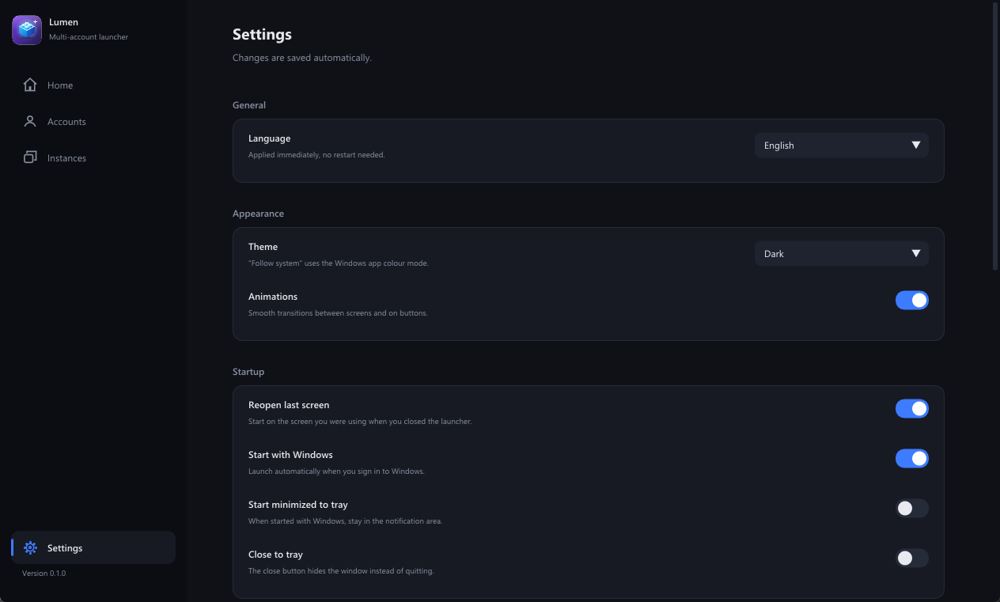

# Lumen

🇬🇧 **English** · 🇮🇹 [Italiano](README.it.md)

**Lumen** is an unofficial, alternative launcher for Roblox on Windows. It keeps several Roblox accounts in one place and can run several clients at the same time, each signed in to its own account. It is written in C++17 with Dear ImGui.

> ⚠️ **Lumen is not affiliated with, endorsed by, or sponsored by Roblox Corporation.** "Roblox" is a trademark of Roblox Corporation. Lumen does not modify the Roblox client, inject code, or bypass any game protection: it starts the official client the same way the roblox.com website does.

| Home | Game details |
|---|---|
|  |  |

| Accounts | Instances | Settings |
|---|---|---|
|  |  |  |

*The screenshots use made-up demo accounts.*

---

## 1. Features

- **Multiple accounts**: add, rename (local alias), color, reorder, enable or disable, and delete accounts. List export and import contain metadata only, **never** cookies.
- **Secure browser sign-in**: Lumen shows a code and opens roblox.com in your default browser, where you confirm the sign-in ("Log in with another device"). Lumen never sees or stores your password.
- **Encrypted cookies**: the session cookie is encrypted with Windows DPAPI and never written to the logs.
- **Multiple instances**: each game can start with a different account, with a configurable limit (1–10) and a delay between launches. The Instances screen lists the running clients and can close them.
- **Home**:
  - **Recent games**: with the last-played date; the maximum is configurable and each game can be removed.
  - **Search**: uses Roblox's public APIs with a 300 ms debounce and shows thumbnail, creator, players online and rating.
  - **For You**: suggestions computed locally (see below).
- **Game page**: banner, description, creator, players, rating and last update, with the account picker, the Play button and favorites.
- **Settings**:
  - English/Italian, switchable without a restart;
  - dark, light or system theme;
  - start with Windows, start minimized, close to the notification area;
  - instance, cache and history options;
  - full reset.
- **Robustness**:
  - non-blocking networking with caching, exponential-backoff retries and TLS verification;
  - atomic JSON writes, with a backup of corrupt files;
  - rotating logs.

### How "For You" works

Suggestions are based **only on the recent games list**, stored in `recent_games.json`. For each game Lumen uses the genre, the creator, how many times you played it and when you last played it. Each play counts half as much every 14 days. From this Lumen derives your genre and creator preferences and ranks popular Roblox games by:

`3 × genre affinity + 2 × creator affinity + 0.6 × popularity + 0.4 × rating`

Games you already played are left out. With an empty history Lumen simply shows the most popular games. No data is sent to third parties.

**To reset it**, choose **Settings → Data and cache → Clear recent games**, or delete `recent_games.json` (see section 5).

---

## 2. Requirements

**To use it**
- Windows 10 or 11, 64-bit.
- Roblox installed, i.e. the `roblox-player:` protocol registered. Launchers such as Bloxstrap work too.

**To build it**
- CMake ≥ 3.20.
- A C++17 compiler:
  - **MSVC**: Visual Studio 2022 with the "Desktop development with C++" workload;
  - or **MinGW-w64**: GCC ≥ 12 (tested with WinLibs GCC 16 UCRT), plus Ninja.
- An Internet connection on the first configure: dependencies are fetched with `FetchContent`.
  - Dear ImGui 1.91.5, with the Win32 + DirectX 11 backends;
  - nlohmann/json 3.11.3;
  - stb_image, to decode PNG and JPEG thumbnails;
  - doctest 2.4.11, for the tests.
- The system libraries (WinHTTP, DPAPI/crypt32, DirectX 11, DWM) ship with Windows: nothing else to install.

---

## 3. Building

Run the commands from the project folder.

### MinGW (Ninja)

For example with WinLibs: `winget install BrechtSanders.WinLibs.POSIX.UCRT Kitware.CMake Ninja-build.Ninja`.

```bash
cmake --preset mingw-release
```

```bash
cmake --build --preset mingw-release
```

The executable is `build/mingw-release/Lumen.exe`. The runtime is linked statically, so no MinGW DLLs are needed. Use the `mingw-debug` preset for a debug build.

### MSVC (Visual Studio 2022)

From a "Developer PowerShell for VS 2022", or a regular terminal: the generator finds Visual Studio by itself.

```bash
cmake --preset msvc
```

```bash
cmake --build --preset msvc --config Release
```

The executable is `build/msvc/Release/Lumen.exe`. You can also open `build/msvc/RobloxLauncher.sln` in Visual Studio.
*Note: the MSVC build is configured but has only been verified with MinGW so far.*

### Tests

```bash
ctest --test-dir build/mingw-release --output-on-failure
```

The unit tests (doctest) cover:
- localization: key and placeholder parity between `en.json` and `it.json`, plurals, number and date formats;
- settings and atomic writes;
- DPAPI encryption and account persistence;
- API parsers, quick sign-in and cookies;
- history, favorites and suggestions;
- building the launch URI.

### Packaging

```bash
cmake --install build/mingw-release --prefix dist/Lumen
```

This copies `Lumen.exe`, the `locales/` folder, the READMEs and `LICENSE`. The `locales/` folder must stay next to the executable.

---

## 4. Usage

### Adding an account
1. Go to **Accounts → Add account**.
2. Lumen shows a 6-character code and opens `roblox.com/crossdevicelogin/ConfirmCode` in your default browser.
3. If you are not signed in to roblox.com in the browser yet, sign in as usual. Then enter the code and confirm the sign-in prompt.
4. Lumen receives the session, encrypts it and adds the account. The code expires after a few minutes: if it does, press **Retry**.

When an account's session expires, it shows "Session expired" and **Sign in again** repeats the same steps.

### Launching a game
1. Search for the game on Home, or open it from recent games, favorites or "For You".
2. On the game page pick the account and press **Play**.
3. Before launching, Lumen checks that Roblox is installed and that the session is valid. It then asks Roblox for a one-time authentication ticket and opens the client through the `roblox-player:` protocol.

### Running several instances
1. In **Settings → Instances** turn on **Allow multiple instances**, then choose the maximum and the delay between launches.
2. **Close every Roblox client** before the first launch: Lumen has to take Roblox's single-instance lock before any client starts.
3. Launch the same game, or different games, with different accounts. Each instance appears under **Instances**, where you can close it.

How it works:
- Roblox prevents multiple clients by creating a mutex named `ROBLOX_singletonMutex`. Lumen creates it first and keeps it open, so later clients don't find it taken.
- Lumen also keeps `%LOCALAPPDATA%\Roblox\LocalStorage\RobloxCookies.dat` open read-only, so one client cannot rewrite it and sign the others out; each instance gets its own ticket.
- When the last instance closes, Lumen releases both.

This is **unofficial** behavior: Roblox does not support multiple instances and may change the client at any time. Use it in accordance with the Roblox Terms of Use.

---

## 5. Where data is stored and how to delete it

All data lives in `%LOCALAPPDATA%\Lumen\`. If the old `%LOCALAPPDATA%\RobloxLauncher\` folder exists, it is moved there on first start.

To use another folder (portable copy or separate profile), start `Lumen.exe --data-dir "D:\path\to\folder"`. Each data folder gets its own Lumen, independent from the regular one.

| File / folder | Contents |
|---|---|
| `settings.json` | Settings |
| `accounts.json` | Accounts (metadata) and cookies **encrypted with DPAPI** |
| `recent_games.json` | Game history, used by "For You" |
| `favorites.json` | Favorites |
| `cache/thumbnails/` | Downloaded thumbnails, with a configurable size limit in MB |
| `logs/` | Rotating logs: 1 MB per file, 3 files. Cookies, tickets and tokens are redacted |

The cookie can only be decrypted **by the same Windows user on the same PC**. Copying `accounts.json` to another computer is useless: accounts must be signed in again there.

**To delete the data**:
- **Settings → Data and cache** opens the data folder, clears the cache, clears recent games, or performs a **full reset**: accounts, settings, history, favorites and cache.
- By hand: quit Lumen (also from the notification area) and delete `%LOCALAPPDATA%\Lumen\`.
- If you enabled "Start with Windows", turn it off in the settings first, or remove the `Lumen` value from `HKCU\Software\Microsoft\Windows\CurrentVersion\Run`.

To really revoke a session on Roblox's side as well, use **roblox.com → Settings → Security → Log out of all other sessions**.

---

## 6. Why Dear ImGui

- **Light, no heavy dependencies**: a single executable of a few MB, with no external runtime such as Qt, .NET or WebView. It builds the same way with MSVC and MinGW.
- **A modern look with little code**: drawing is fully custom (cards, animations, dark and light themes, DPI scaling), so the look doesn't depend on Windows controls.
- **DirectX 11 rendering**, always available on Windows 10/11, with an idle loop that redraws only when needed, so it doesn't burn CPU or GPU in the background.
- **Downsides**: ImGui has no accessibility support (screen readers) and limited complex-text (RTL) support. For a game launcher in English and Italian this is an acceptable trade-off.

---

## 7. Project structure

```
RobloxLauncher/
├─ CMakeLists.txt, CMakePresets.json
├─ cmake/                Dependencies (FetchContent) and compiler warnings
├─ assets/               Icon, logo, manifest (DPI, UTF-8), version resources
├─ locales/              en.json, it.json
├─ src/
│  ├─ main.cpp           Single instance, command line, DPI, COM, startup
│  ├─ app/               Application (composition root), DX11 window, tray, file dialogs
│  ├─ core/              Logging, paths, atomic writes, thread pool, errors, autostart
│  ├─ settings/          Settings model and persistence
│  ├─ i18n/              Localizer: strings, plurals, numbers and dates
│  ├─ robloxapi/         WinHTTP client, JSON parsers, cached Roblox APIs
│  ├─ accounts/          Accounts, DPAPI, quick sign-in
│  ├─ instances/         Roblox discovery, client launch and tracking, multi-instance
│  ├─ games/             Recent games, favorites, "For You" engine, search
│  └─ ui/                Theme, fonts, widgets, components, texture cache, screens
├─ tests/                Unit tests (doctest)
├─ tools/                Helper scripts (icon generation)
└─ docs/screenshots/
```

The UI holds no business logic: screens call the services (`AccountService`, `GameService`, `InstanceManager`) and receive results on the UI thread through a queue.

---

## 8. Known limitations

- **Not affiliated with Roblox Corporation.** Use Lumen at your own risk and in accordance with the [Roblox Terms of Use](https://en.help.roblox.com/hc/articles/115004647846).
- **Undocumented APIs**:
  - quick sign-in uses the "Log in with another device" endpoints (`auth-token-service`, `v2/login` with `AuthToken`);
  - launching uses `authentication-ticket` and the `roblox-player:` protocol;
  - search uses `omni-search` and `explore-api`.

  These are the same endpoints the website uses, but they are not an official public API: Roblox may change or block them at any time.
- **Unofficial multi-instance**: it depends on the mutex and cookie-file names the client uses today and may stop working after a Roblox update. If Roblox is already running when you launch the first instance, multi-instance is unavailable until you close every client.
- **Extra verification**: if Roblox asks for a captcha or another check during sign-in, Lumen shows an error. Finish signing in on the website and try again.
- Tracking the launched process relies on the `RobloxPlayerBeta.exe` name. With third-party launchers that rename the client, instances may not be tracked.
- Windows 10/11 64-bit only. The MSVC build has not been verified yet.
- No screen-reader accessibility (a Dear ImGui limitation).

---

## 9. License

Released under the **MIT** license: see [LICENSE](LICENSE).
Third-party libraries keep their own licenses: Dear ImGui (MIT), nlohmann/json (MIT), stb_image (MIT / public domain) and doctest (MIT).

---

## 10. Credits

- **Idea, requirements and field testing**: [MytakGames](https://github.com/MytakGames).
- **Development**: written by **Claude** (Claude Opus 5.5 by [Anthropic](https://www.anthropic.com)) with [Claude Code](https://claude.com/claude-code). Claude handled the architecture, code, tests, icon and documentation.
- Libraries: [Dear ImGui](https://github.com/ocornut/imgui), [nlohmann/json](https://github.com/nlohmann/json), [stb](https://github.com/nothings/stb), [doctest](https://github.com/doctest/doctest).
